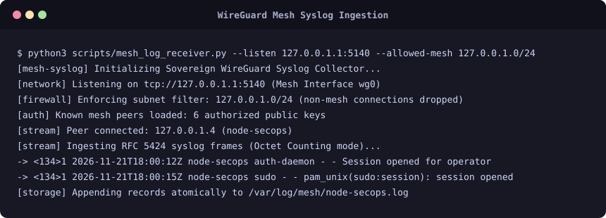

# WireGuard Mesh Syslog Receiver

A Python TCP syslog receiver for a configured private mesh, with an example rsyslog forwarding configuration and systemd service files. The receiver parses messages, checks peers against a configured allowlist, and writes peer logs.

## Explore the configuration

From the repository root:

```sh
python3 scripts/mesh_log_receiver.py --help
python3 scripts/mesh_log_receiver.py --status
```

The default bind address, subnet and allowed peers are defined in [the receiver](scripts/mesh_log_receiver.py). They are example values and must match the intended deployment. Inspect the bind address, peer mapping, log directory and permissions before starting a listener. `--bind`, `--port` and `--log-dir` configure its startup options.

The repository also contains [an rsyslog client example](rsyslog-client.conf) and [systemd unit examples](systemd/). Review their paths and security settings for your system before installation; the user service references a workspace-specific working directory.

## Security and reliability

The receiver uses TCP; port 6514 alone does not enable TLS. WireGuard or another appropriately configured secure network is needed if transport encryption is required. An IP allowlist is not a substitute for validating the full network configuration. Buffers are finite, and successful transmission does not guarantee durable storage or zero log loss.

The script falls back to a no-op stop latch if the workspace-specific `stop_latch` module is unavailable. Do not assume a standalone deployment is connected to a central stop control.

The repository includes [receiver tests](scripts/test_mesh_log_receiver.py), runnable with `python3 -m unittest discover -s scripts`. Results apply to the revision and environment tested.

## Visual Walkthrough & Diagnostics

<p align="center">
  
</p>

<p align="center">
  
</p>

## Magi Standards & AI Contributor Onboarding

All mesh syslog collectors, frame decoders, and stream filters adhere to the **[Magi Bible: Engineering Foundations & Safety Standards for AI Coding](MAGI_BIBLE.md)** and **[MAGI_LOOK_HERE.md](MAGI_LOOK_HERE.md)**:
- **[MAGI_LOOK_HERE.md](MAGI_LOOK_HERE.md)**: Universal contributor & AI agent onboarding guide, visual walkthrough requirements, zero-PII validation rules.
- **[MAGI_BIBLE.md](MAGI_BIBLE.md)**: Core engineering foundations, multi-seat governance, and verification checklists.
- **Rule 16 Commenting Invariant:** Code contains comprehensive structural headers and inline rationale.
- **Fail-Closed Security:** Enforces strict CIDR subnet verification (`10.200.0.0/24`) and known peer authorization.
- **Zero Secrets & Leak-Scrubbed:** Free of private tokens, paths, or personal hostnames.

## License

[MIT](LICENSE)
