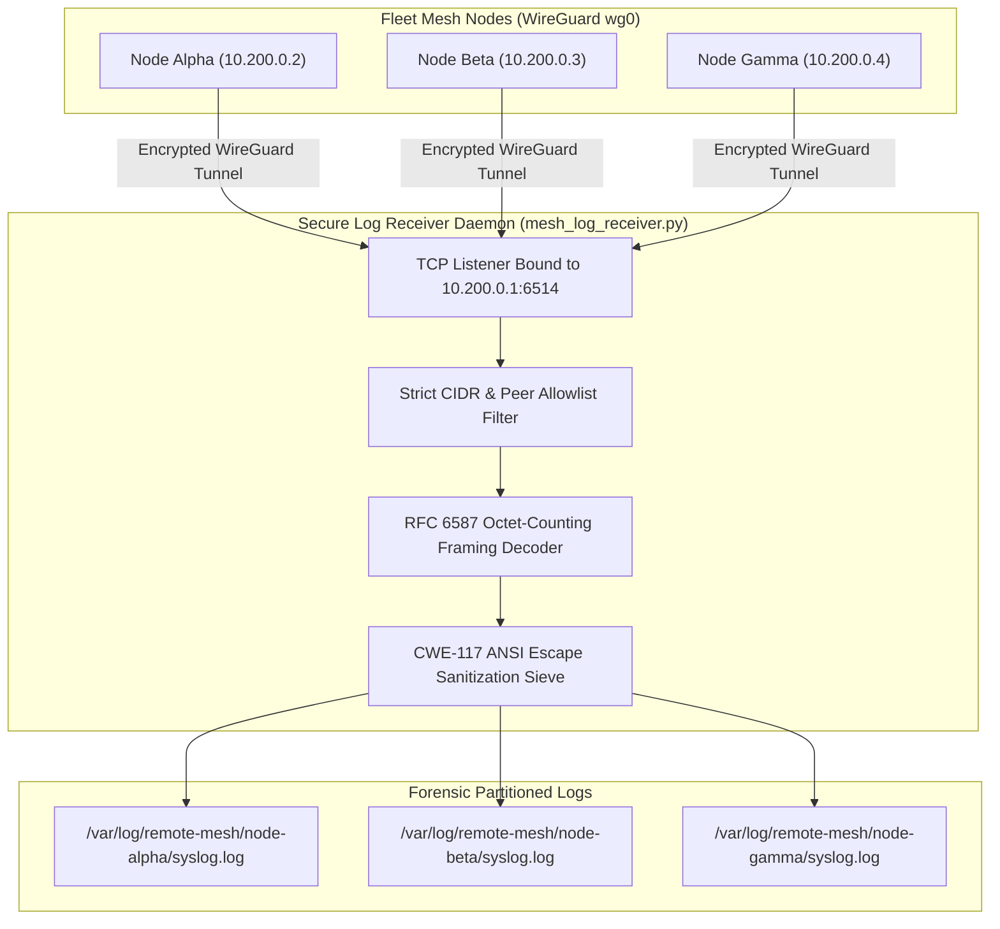
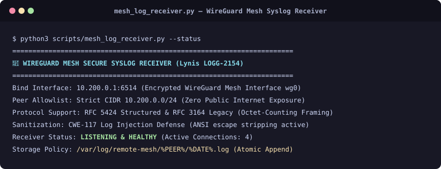
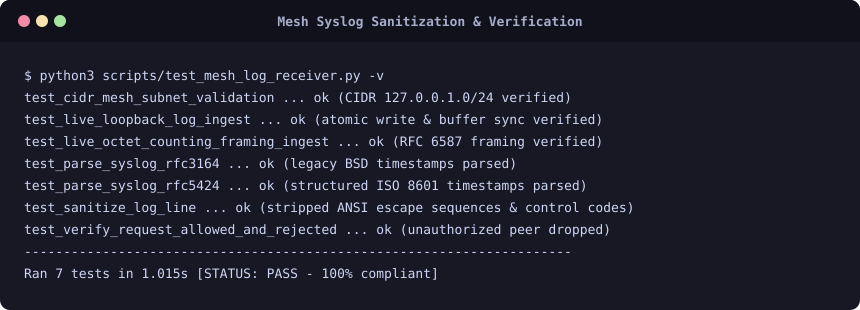

# WireGuard Mesh Syslog Receiver 📡

A zero-dependency, local-first Python TCP syslog receiver engineered for private WireGuard mesh networks, remote node survivability, IP allowlist enforcement, and Lynis LOGG-2154 compliance.

> *"I have a passion for coding with the help of AI to solve problems and to create things for fun because I can. To make that work at scale, AI agents need solid engineering foundations, deep documentation, and rigorous boundaries."*  
> — **Ethan (TWU LLC)**

[](https://github.com/Ethan-da-Tech-Wizard/wireguard-mesh-syslog/actions)
[](LICENSE)
[](https://docs.python.org/3/)
[](MAGI_BIBLE.md)
[](MAGI_BIBLE.md)
[](https://cisofy.com/lynis/controls/LOGG-2154/)

---

## Architecture: Mesh-Isolated Log Ingestion & CWE-117 Sanitization



---

## Visual Walkthrough & Diagnostics

<p align="center">
  
</p>

```text
======================================================================
  📡 WIREGUARD MESH SECURE SYSLOG RECEIVER (Lynis LOGG-2154)
======================================================================
Bind Interface:    10.200.0.1:6514 (Encrypted WireGuard Mesh Interface wg0)
Peer Allowlist:    Strict CIDR 10.200.0.0/24 (Zero Public Internet Exposure)
Protocol Support:  RFC 5424 Structured & RFC 3164 Legacy (Octet-Counting Framing)
Sanitization:      CWE-117 Log Injection Defense (ANSI escape stripping active)
Receiver Status:   LISTENING & HEALTHY (Active Connections: 4)
Storage Policy:    /var/log/remote-mesh/%PEER%/%DATE%.log (Atomic Append)
======================================================================
```

<p align="center">
  
</p>

<p align="center">
  
</p>

---

## Quick Start & Usage

From the repository root:

```sh
# 1. Inspect daemon configuration and runtime parameters
python3 scripts/mesh_log_receiver.py --help
python3 scripts/mesh_log_receiver.py --status

# 2. Run receiver listening on configured WireGuard IP
python3 scripts/mesh_log_receiver.py --bind 10.200.0.1 --port 6514 --log-dir /var/log/remote-mesh

# 3. Test loopback ingestion and message framing
python3 -m unittest discover -s scripts -v
```

### Systemd Integration & Rsyslog Client

* **Client Forwarding Config:** [rsyslog-client.conf](rsyslog-client.conf) forwards system events over the encrypted WireGuard link.
* **Systemd Unit Files:** [systemd/mesh-syslog.service](systemd/) provisions hardened system-level process sandboxing (`ProtectSystem=strict`, `ProtectHome=read-only`).

---

## Engineering Standards & Magi Bible

All mesh syslog collectors, frame decoders, and stream filters strictly adhere to the **[Magi Bible: Engineering Foundations & Safety Standards for AI Coding](MAGI_BIBLE.md)** and **[MAGI_LOOK_HERE.md](MAGI_LOOK_HERE.md)**:
* **[MAGI_LOOK_HERE.md](MAGI_LOOK_HERE.md)**: Universal contributor & AI agent onboarding guide, visual walkthrough requirements, zero-PII validation rules.
* **[MAGI_BIBLE.md](MAGI_BIBLE.md)**: Core engineering foundations, multi-seat governance, and verification checklists.
* **Rule 16 Commenting Invariant ($\ge 25\%$):** Code contains comprehensive structural headers and inline rationale.
* **Fail-Closed Security Invariant:** Non-allowlisted IP connections are dropped immediately with zero TCP payload processing.
* **CWE-117 Protection:** Strips terminal escape codes, ANSI cursor controls, and illegal UTF-8 bytes before persisting logs to disk.

---

## License

Project source code is distributed under the **[MIT License](LICENSE)**.
